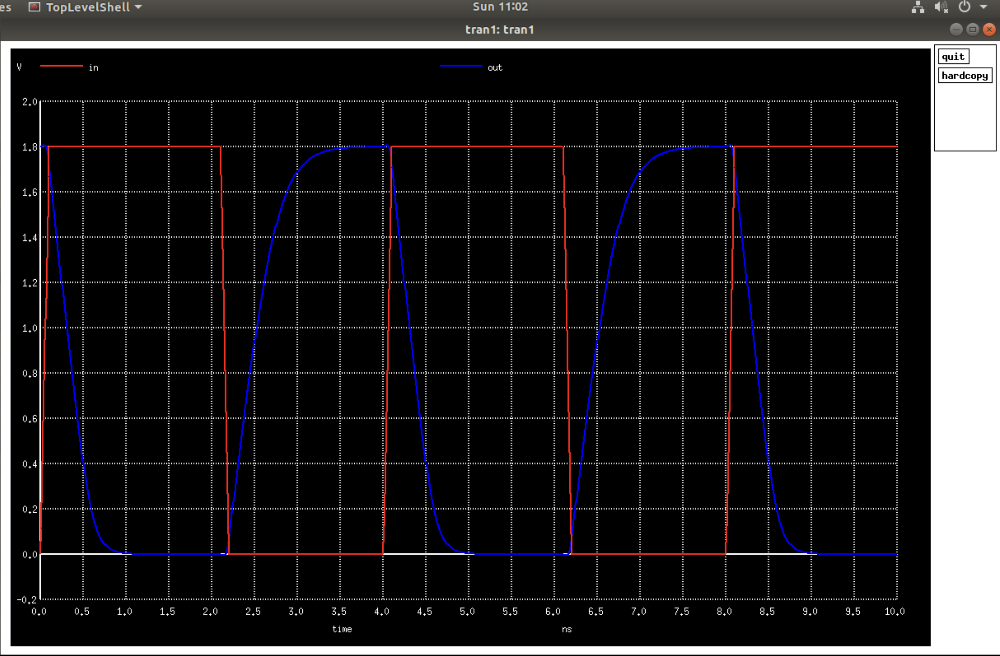
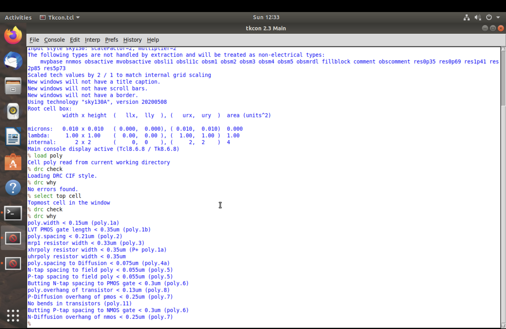

# Module 3: Design Library Cell Using Magic Layout and ngspice Characterization

This module covers SPICE-level characterization of a CMOS inverter, physical layout in Magic, and Design Rule Check (DRC) verification using the Sky130 PDK. The workflow starts with transistor-level simulation in ngspice, continues with layout creation and extracted-netlist simulation in Magic, and finishes with experiments that demonstrate Sky130 technology-file DRC rules.

## Module Overview

### SKY130_D3_SK1: SPICE Deck Creation and ngspice Simulation

Two inverter sizing cases are simulated with Sky130 device models. Case d1 uses a PMOS width of 0.84 um and an NMOS width of 0.36 um; case d2 increases the PMOS width to 2.1 um while keeping the NMOS width at 0.36 um. DC sweeps produce voltage-transfer characteristics (VTCs) for comparing the switching region and threshold. Transient analyses use a pulsed input to observe inverter switching and compare the response of the two sizing cases.

### SKY130_D3_SK2: Magic Layout and Extracted-Netlist Simulation

The inverter is laid out in Magic with the Sky130A technology setup. A SPICE netlist is then extracted from the layout and simulated. This connects the transistor-level circuit work to its physical implementation and checks that the extracted design retains inverter behavior.

### SKY130_D3_SK3: Sky130 Tech-File DRC Labs

Poly and nwell test layouts are opened in Magic and checked against the Sky130 technology rules. The test examples include geometry intended to demonstrate rule-compliant and rule-violating cases; Magic's DRC results identify the violations for inspection.

## Learning Objectives

- Write and run ngspice decks for a CMOS inverter using Sky130 device models.
- Generate and interpret DC voltage-transfer characteristics for two transistor-sizing cases.
- Observe how changing PMOS width affects inverter switching behavior.
- Compare pulsed-input transient responses for the two cases.
- Create an inverter layout in Magic and simulate its extracted SPICE netlist.
- Use Magic DRC results to study poly and nwell geometry rules.

## Overall Workflow

`Create inverter SPICE decks` -> `run DC and transient analyses` -> `compare sizing cases` -> `build the inverter layout in Magic` -> `extract and simulate the layout netlist` -> `inspect poly and nwell DRC examples`

## Image-by-Image Guide

The descriptions below follow the simulation and layout workflow. The transient screenshots with the `ngspice_` and `SKY_D3_` prefixes document the initial and final views of the corresponding sizing-case results.

### SKY130_D3_SK1: SPICE Decks and Simulation

#### 1. `d1_spice.png` - First inverter SPICE deck

This deck defines the first CMOS inverter sizing case: PMOS width Wp = 0.84 um and NMOS width Wn = 0.36 um. It provides the circuit and simulation setup used as the baseline for comparing the second case.

#### 2. `d1_plot_in_vs_out.png` - First-case DC transfer characteristic

This plot shows the inverter output as the input voltage is swept for case d1. The output changes from its high level to its low level through the transition region. The switching threshold can be estimated from the curve, particularly near the point where input and output voltages are equal.

#### 3. `d2_spice.png` - Second inverter SPICE deck

This deck defines case d2, increasing the PMOS width to 2.1 um while retaining the 0.36 um NMOS width. Comparing it with d1 shows the effect of changing the relative pull-up and pull-down drive strengths while using the same inverter circuit approach.

#### 4. `d2_plot_in_vs_out.png` - Second-case DC transfer characteristic

This is the d2 voltage-transfer plot. Compare its transition region and switching point with the d1 plot to see how the wider PMOS changes the inverter's DC response. The comparison should be made using the plotted values and axes rather than assuming a particular threshold shift.

#### 5. `ng_spice.png` - ngspice simulation output

This screenshot records the ngspice console during the inverter simulation work. It provides evidence of the simulator session and its analysis output, complementing the decks and plotted results.

#### 6. `ngspice_transcient1.png` - Initial d1 transient result

This transient simulation applies a pulsed input to the d1 inverter. The input and output traces show the expected inversion over time: when the input is high, the output is low, and when the input is low, the output is high. Edge timing can be examined to understand the switching response.

#### 7. `SKY_D3_SK1_L4_transient_t1.png` - Final d1 transient plot

This is the final t1 transient plot for the d1 sizing case. Read it alongside the earlier d1 transient screenshot; together they document the input pulse and the corresponding inverted output for the first configuration.

#### 8. `ngspice_transcient2.png` - Initial d2 transient result

This transient simulation shows the pulsed-input response for d2, whose PMOS is wider than in d1. Compare its output transitions with the d1 transient result to observe the effect of the changed PMOS drive strength, especially on the output's rising response.

#### 9. `SKY_D3_SK1_L4_transient_t2.png` - Final d2 transient plot

This is the final t2 transient plot for the d2 sizing case. Compare its input and output waveforms with t1 to assess how the larger PMOS affects switching behavior under the same type of pulsed stimulus.

### SKY130_D3_SK2: Magic Layout and Extracted Simulation

#### 10. `SKY_D3_SK2_L1_inverter_layout_magic.png` - Inverter layout in Magic

This screenshot shows the physical layout of the `sky130_inv` cell opened in Magic using the Sky130A technology setup. The layout represents the inverter's device and interconnect geometry, including its power, ground, input, and output connections.

#### 11. `SKY_D3_SK2_L4_transient_output_layout_extracted.png` - Extracted-layout transient simulation

After extracting the layout netlist with Magic (`extract all` followed by `ext2spice`), the extracted circuit is simulated with a transient input. The waveform checks that the layout-derived circuit behaves as an inverter. Any parasitic effects represented in the result depend on the extraction settings used for the netlist.

### SKY130_D3_SK3: Poly and Nwell DRC Labs

#### 12. `SKY_D3_SK3_L1_poly_drc_layout.png` - Poly DRC test layout

This screenshot shows the poly-layer DRC test cell opened in Magic. Its example regions are used to examine poly geometries that are correct by design, intentionally incorrect, or associated with rules not implemented in the test. The layout gives the geometry context needed to interpret the DRC output.

#### 13. `SKY_D3_SK3_L1_poly_drc_log.png` - Poly DRC results

This screenshot shows the poly-rule messages reported for the test layout. The results demonstrate how Magic identifies issues such as width, spacing, overhang, and resistor-related checks. Relate each reported violation to the corresponding geometry in the poly layout.

#### 14. `SKY_D3_SK3_L2_nwell_drc_layout.png` - Nwell DRC test layout

This screenshot shows the nwell-layer test cell in Magic. It provides the physical examples used to inspect well geometry and to compare rule-compliant shapes with intentionally incorrect cases.

#### 15. `SKY_D3_SK3_L2_nwell_drc_check.png` - Nwell DRC results

This screenshot records the DRC output for the nwell test layout. The reported checks demonstrate how Magic flags nwell width, spacing, and overlap issues. Read these results together with the nwell layout to connect the rule messages to the shapes being checked.

## Summary

Module 3 follows a standard-cell characterization flow from circuit to layout. The two SPICE decks and their DC and transient simulations show how inverter sizing affects electrical behavior. Magic is then used to create and inspect the physical inverter, extract a netlist for simulation, and examine Sky130 poly and nwell design-rule checks.

## Author

- **Name:** Nukala Shiva Shankar
- **Roll No.:** 24EG104E28
- **College:** Anurag University