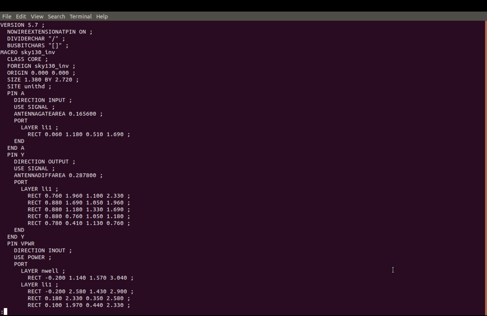
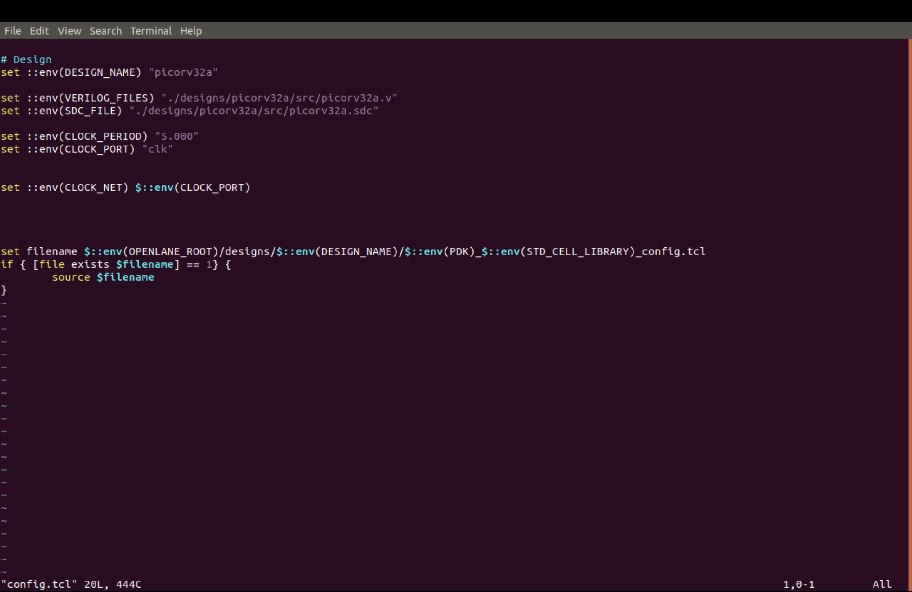
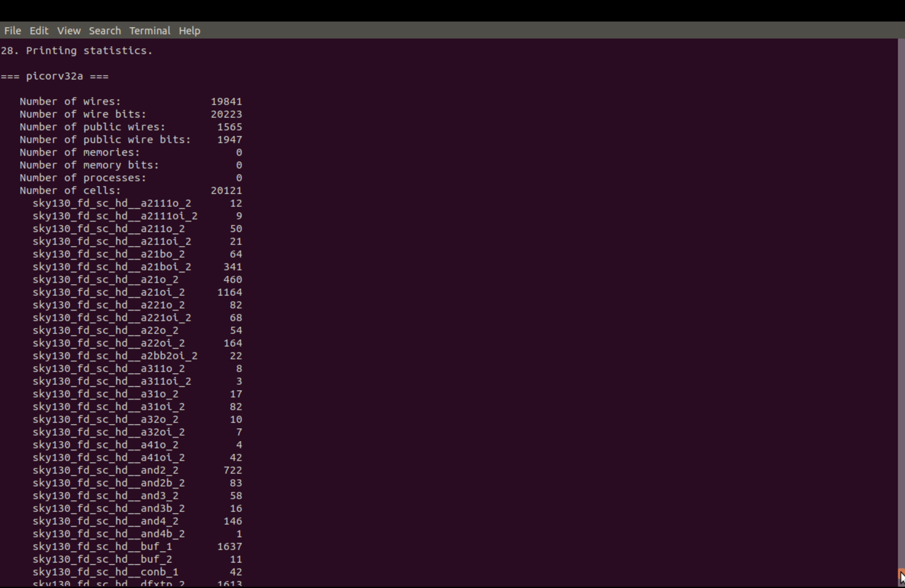
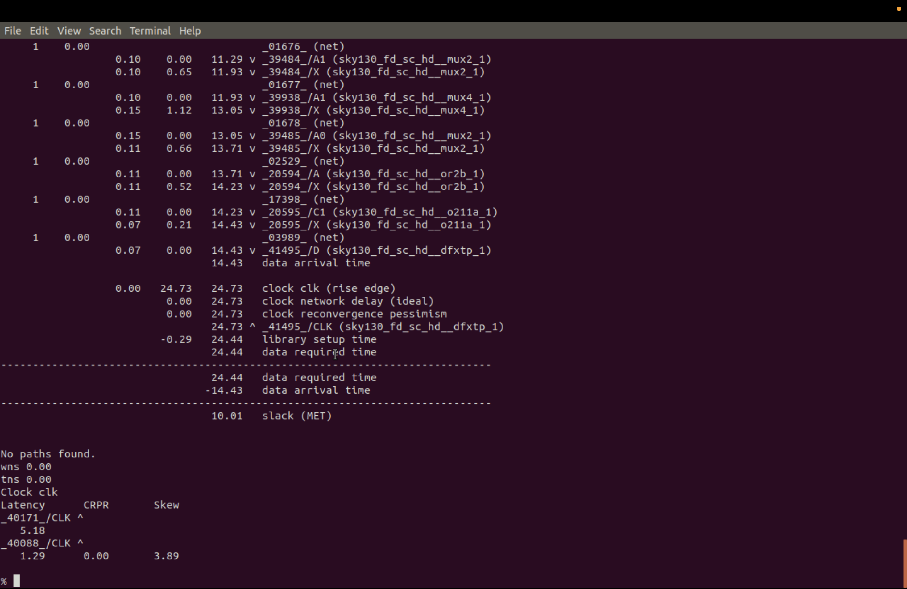
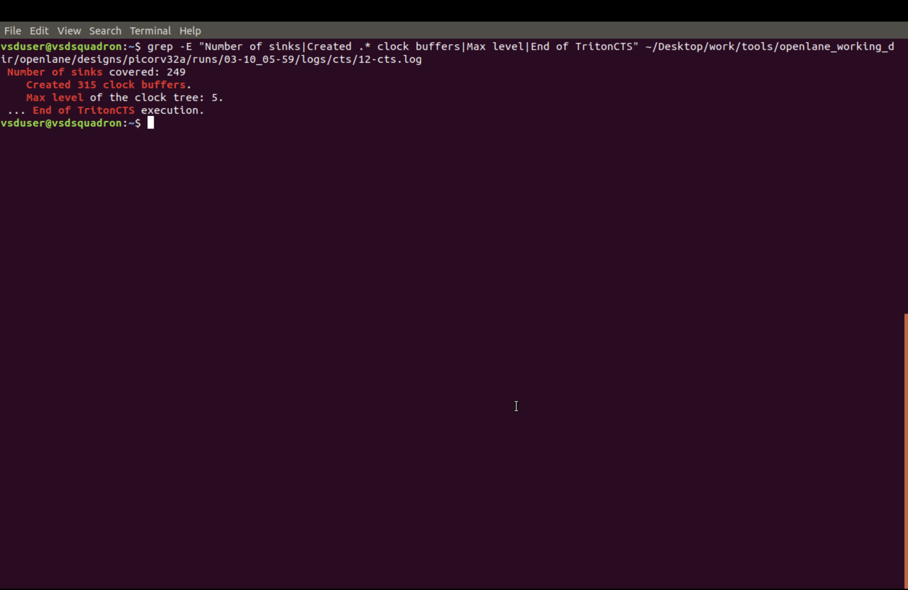

# Module 4: Pre-Layout Timing Analysis and Clock Design

This module records the custom-cell integration, synthesis timing optimization, floorplanning, placement, and clock-design work completed for the Sky130 `picorv32a` design. The lab sequence begins with the inverter macro and continues through timing analysis, ideal-clock STA, clock-tree synthesis (CTS), and post-CTS verification. The screenshots in this directory capture the key design and timing milestones of the flow.

## Objectives

- Understand how standard-cell timing models and delay tables are used before detailed routing.
- Relate placement-grid dimensions to routing-track dimensions.
- Create a custom Sky130 inverter layout and generate its LEF abstract.
- Integrate LEF and Liberty files into the OpenLane `picorv32a` flow.
- Compare synthesis timing and area before and after timing-oriented synthesis settings.
- Review a critical timing path and verify timing through floorplanning and placement.
- Run ideal-clock STA and then perform clock-tree synthesis and post-CTS timing analysis.
- Study setup and hold timing, clock uncertainty, skew, and CTS behavior before routing.

## Completed Workflow

### 1. SKY130_D4_SK1 - Timing Model and Custom Cell Integration

The first stage creates a custom inverter standard cell and makes its physical and timing views available to OpenLane.

1. Open `sky130_inv.mag` in Magic using the `sky130A.tech` technology setup.
2. Set the layout grid to `grid 0.46um 0.34um 0.23um 0.17um` so the geometry can be checked against the intended track and placement-grid dimensions.
3. Inspect the four cell terminals: `VPWR` is power, `VGND` is ground, `A` is the signal input, and `Y` is the signal output.
4. Write the abstract from Magic with `lef write`; this produces `sky130_inv.lef`.
5. Copy the LEF and the fast, slow, and typical Liberty files into `designs/picorv32a/src/`.
6. Update `config.tcl` with `EXTRA_LEFS`, `LIB_SYNTH`, `LIB_FASTEST`, `LIB_SLOWEST`, and `LIB_TYPICAL` so the flow loads the physical and timing views.
7. Run `prep -design picorv32a` and confirm that the custom-cell abstract is included in `merged_unpadded.lef`.

The generated LEF and Magic screenshots confirm the physical inverter macro and its terminals. This is the foundation for using the custom cell in the RTL-to-GDSII flow.

### 2. SKY130_D4_SK2 - Synthesis and Timing Investigation

The next stage runs synthesis with the default strategy, inspects the failing timing path, and then reruns the flow with timing-oriented synthesis settings. The recorded settings for the second run are `SYNTH_STRATEGY "DELAY 0"`, `SYNTH_BUFFERING 1`, and `SYNTH_SIZING 1`.

The default run showed negative timing slack, and the OpenSTA report identifies a register-to-register maximum-delay path in the `clk` path group. The critical path passes through OR-related logic and a long reduction chain, which explains the reported setup issue. The custom cell is made available through its LEF and Liberty views, but synthesis still chooses the mapped cells based on the optimization goals and available library timing.

After applying the timing-oriented synthesis settings, the report shows WNS and TNS at zero, with a larger chip area. This demonstrates the design tradeoff between better timing closure and higher area cost.

### 3. SKY130_D4_SK3 - Floorplan and Placement

The timing-optimized design is then taken through `run_floorplan` and `run_placement`. The floorplan report gives a die boundary from `(0.0, 0.0)` to `(746.915, 757.635)` microns and a core boundary from `(5.52, 10.88)` to `(741.06, 745.28)` microns.

Placement reports 18,673 instances, 20,721 nets, 41% utilization, 58% padded utilization, and 270 rows. The reported WNS and TNS remain zero after placement. The placement image shows the placed standard-cell layout and confirms the physical placement result for `picorv32a`.

### 4. SKY130_D4_SK4 - Ideal-Clock STA, CTS, and Post-CTS Timing

The final stage in this module moves from placement into timing analysis for the clock network.

- Ideal-clock STA checks the design under a reference clock model before detailed clock insertion.
- CTS generates the clock tree and balances the clock network across the placed cells.
- Post-CTS real-clock STA verifies timing after the clock tree has been synthesized and actual skew/delay effects are included.

The CTS screenshots document the clock-tree command execution, the timing slack view, and the clock-skew analysis. The post-CTS timing screenshot shows the real-clock evaluation after the inserted clock tree, which is the stage used to confirm that the design remains timing-safe after clock distribution.

## Image-by-Image Guide

The list follows the work sequence represented by the screenshots. Each image is stored alongside this README.

### Custom Cell and OpenLane Setup

#### 1. `checking_inv_magic_layout.png` - Inspecting the inverter in Magic

The Magic window has `sky130_inv` loaded. The console's `what` checks identify the selected `nwell`, `poly`, `metal1`, `ndiff`, and `pdiff` mask layers. Use this image as the layout inspection evidence; the terminal labels and cell setup are part of checking the custom cell before abstract generation.

#### 2. `sky130_inv_lef.png` - Generated LEF abstract

This is the LEF text for macro `sky130_inv`. It declares the macro dimensions and the physical pin shapes/directions for signal pins such as `A` and `Y`, together with the power and ground pins. This is the abstract that the physical-design flow can use instead of reopening the full Magic layout.

#### 3. `config_tcl.png` - Original OpenLane design configuration

This screenshot records the `picorv32a` configuration before the extra custom-cell entries are added. It shows the design name, Verilog and SDC inputs, a 5.000 ns clock period, and `clk` as the clock port/net. It provides the baseline for the configuration update in the next screenshot.

#### 4. `config_extra_lefs_and_libs.png` - Adding LEF and Liberty views

The updated configuration adds an `EXTRA_LEFS` glob for the design's LEF files and points the synthesis and corner-specific library variables to the copied Sky130 Liberty files. These settings connect the custom physical abstract and the timing libraries to the OpenLane run.

### Synthesis and Timing Evidence

#### 5. `synthesis_before_fix_stats.png` - Default synthesis statistics

This report is from the default synthesis run. Its reported chip area is `147712.9184`. The lab notes record this run's timing as WNS `-24.89` and TNS `-759.46`, so the design did not meet the timing target with the default strategy.

#### 6. `opensta_rpt.png` - Critical maximum-delay path

The terminal is displaying the beginning of an OpenSTA report. It identifies a rising-edge register startpoint, a register endpoint, path group `clk`, and path type `max`, then lists cells and delays along the path. The visible logic includes OR-family cells; the accompanying lab analysis attributes the critical delay to a long OR-reduction chain. This is path-level evidence, not a full setup/hold summary.

#### 7. `synthesis_after_fix_stats.png` - Timing-oriented synthesis result

This synthesis report records chip area `196832.528`. The run used `SYNTH_STRATEGY "DELAY 0"`, `SYNTH_BUFFERING 1`, and `SYNTH_SIZING 1`; the lab notes report WNS `0.00` and TNS `0.00` after this change. Compare with image 5: timing improved to the recorded target while area increased.

#### 8. `post_abc_mapped_statistics.png.png` - ABC-mapped cell statistics

This screenshot shows the Yosys statistics after ABC mapping, including mapped Sky130 standard-cell types and counts. It is useful for reviewing what the synthesis flow placed in the mapped netlist; the custom cell's presence in configuration or library files should not be confused with proof that ABC selected it.

### Floorplan and Placement Evidence

#### 9. `floorplan_die_core_area.png` - Die and core dimensions

The terminal prints the floorplan report coordinates. The die spans `0.0 0.0 746.915 757.635` microns, while the core spans `5.52 10.88 741.06 745.28` microns. These values describe the floorplan generated before placement.

#### 10. `placement_design_stats.png` - Placement and design statistics

The OpenROAD output records the placed design's instance and net counts, utilization, row count, and placement analysis. It reports 18,673 instances, 20,721 nets, 41% utilization, 58% padded utilization, and 270 rows. The output also contains legalization and HPWL details and a non-fatal warning that no power special net was found in this captured step; interpret that warning in the context of the run configuration rather than as a placement failure.

#### 11. `picorv32a_placement_layout.png` - Rendered placement

This screenshot shows the generated `picorv32a.placement.def.png` opened after placement. It is the visual view of the placed standard-cell design and complements the textual statistics in image 10.

### Clock Tree Synthesis and Post-CTS Timing

#### 12. `cts_tcl_run_cts.png` - CTS command and execution

This terminal screenshot captures the clock-tree synthesis run. It shows the CTS command context and the resulting insertions and summary. It is the execution evidence that the design clock tree was generated after placement.

#### 13. `cts_timing_slack.png` - Timing slack after CTS

This screenshot shows the slack information associated with the generated clock tree. It is useful for checking whether the post-CTS timing path remains acceptable and for comparing the design state before and after clock insertion.

#### 14. `cts_clock_skew.png` - Clock skew analysis

This screenshot records the clock skew view for the synthesized clock network. The analysis highlights the importance of clock balancing and insertion-delay management in the CTS stage, especially for high-fanout or timing-sensitive nets.

#### 15. `post_cts_real_clock_sta.png` - Real-clock STA after CTS

This screenshot shows the post-CTS timing report under the real-clock model. It demonstrates the timing evaluation after the clock tree has been inserted and the netlist is being checked with the actual clock distribution behavior, including insertion delay and skew considerations.

#### 16. `tritoncts_stats.png` - TritonCTS statistics

This summary captures the clock-tree statistics produced by the CTS engine. It provides context for the generated tree, buffer count, timing effect, and the overall clock-distribution result that sets up the remaining route and final timing checks.

## Flow Summary

`Magic inverter layout` -> `LEF generation` -> `OpenLane LEF/Liberty setup` -> `synthesis timing optimization` -> `floorplan` -> `placement` -> `ideal-clock STA` -> `CTS` -> `post-CTS timing verification`

## Summary

Module 4 follows the complete pre-layout timing and clock-design flow for a Sky130 `picorv32a` digital design. It begins with the custom inverter integration and continues through synthesis, floorplanning, placement, and clock-tree synthesis. The recorded reports and screenshots show how the design is tuned to meet timing before routing begins.

## Author

- **Name:** Nukala Shiva Shankar
- **Roll No.:** 24EG104E28
- **College:** Anurag University
