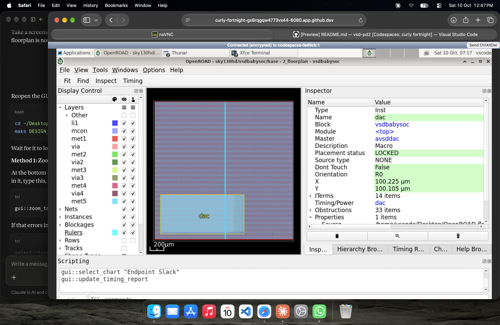
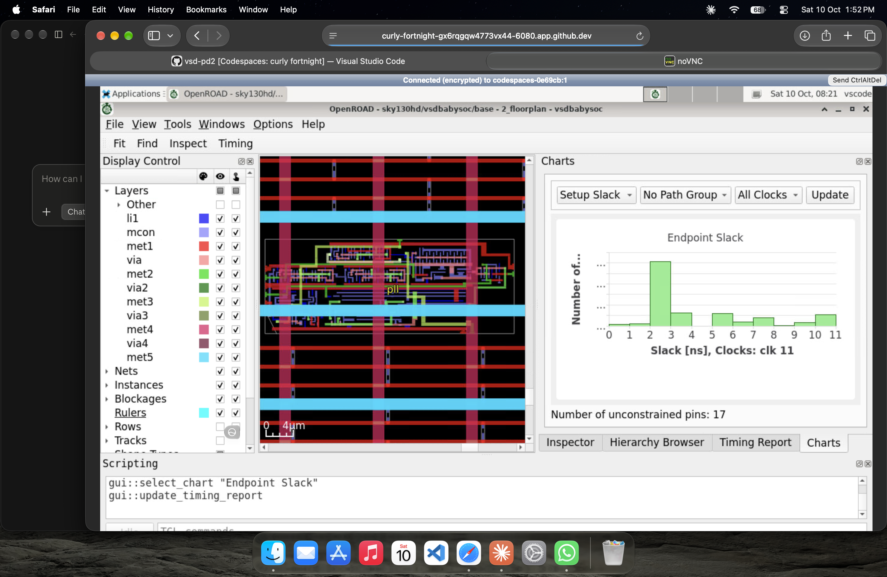
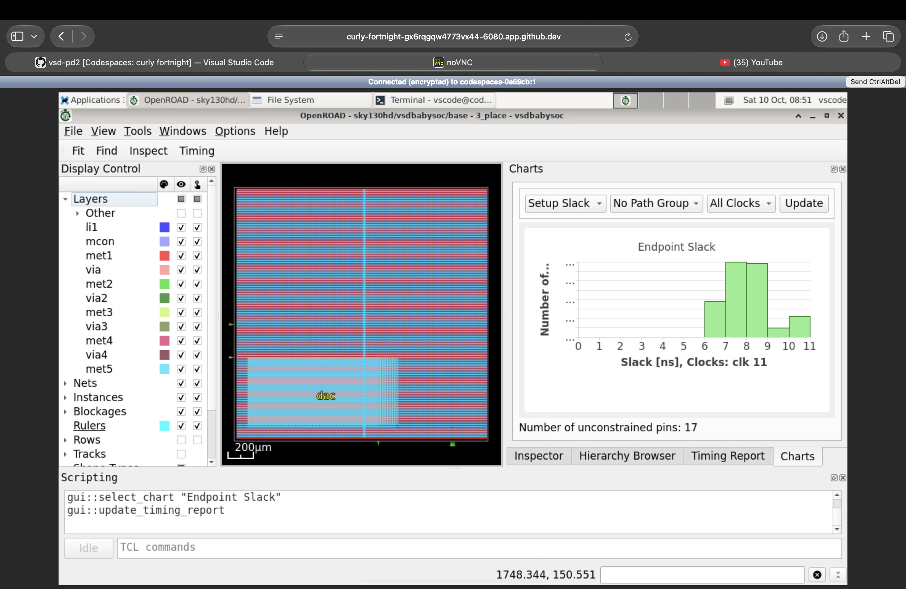
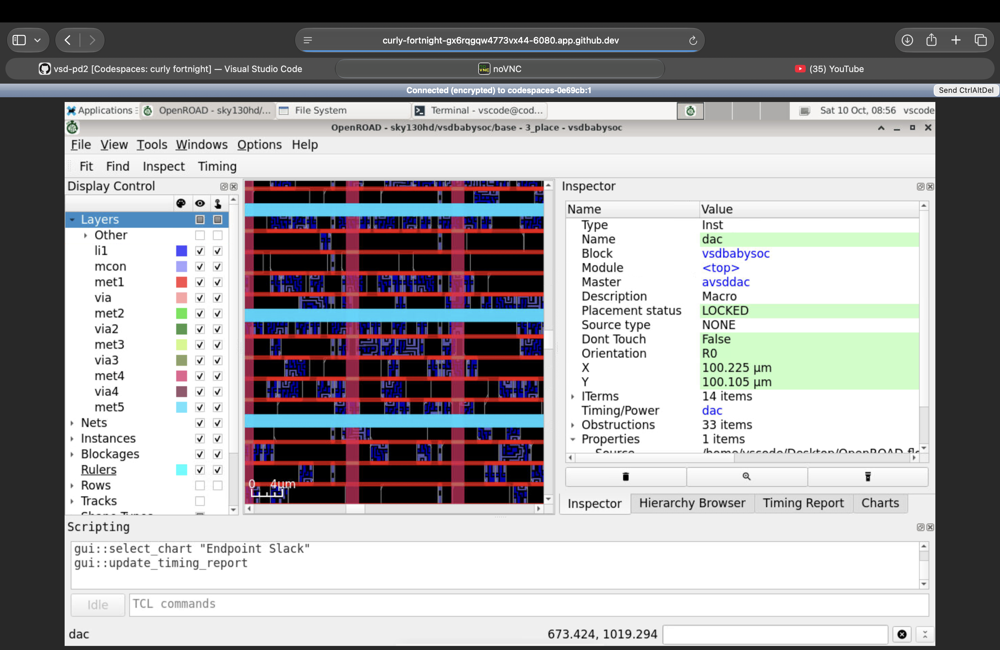
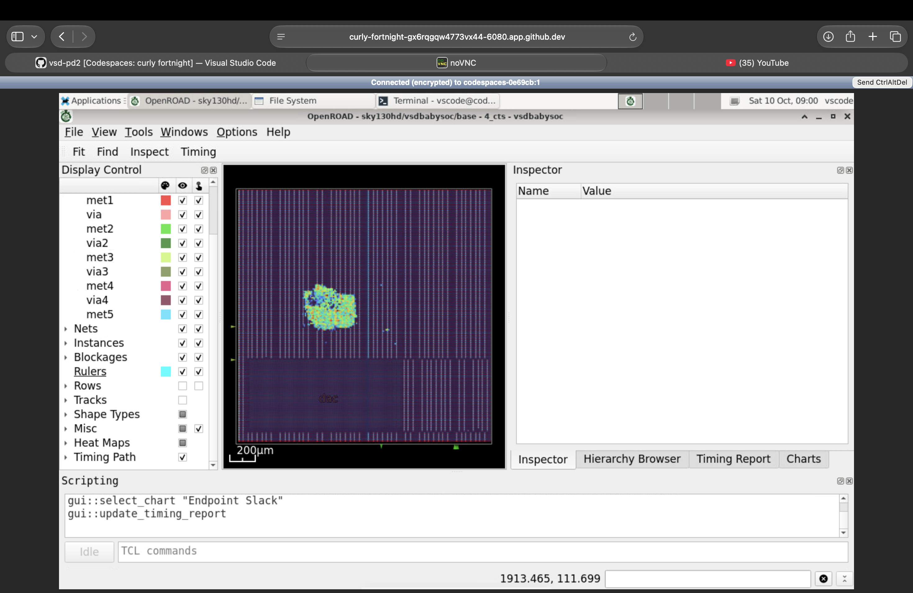
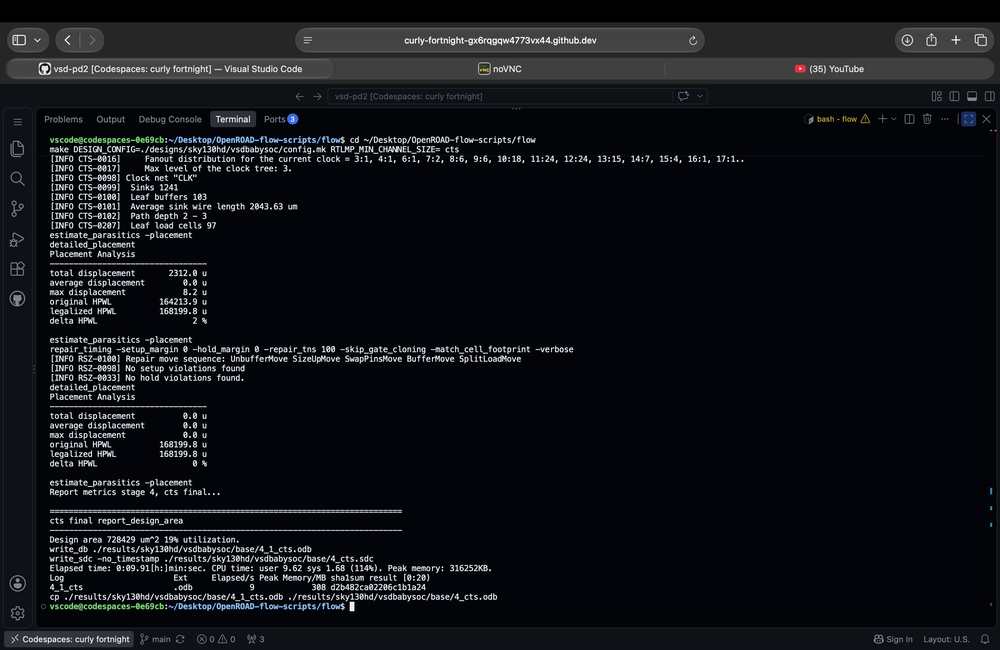
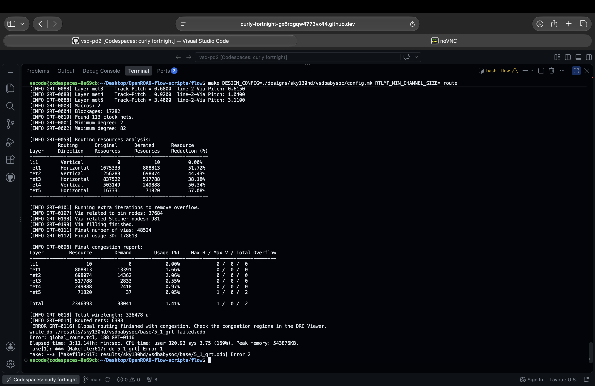
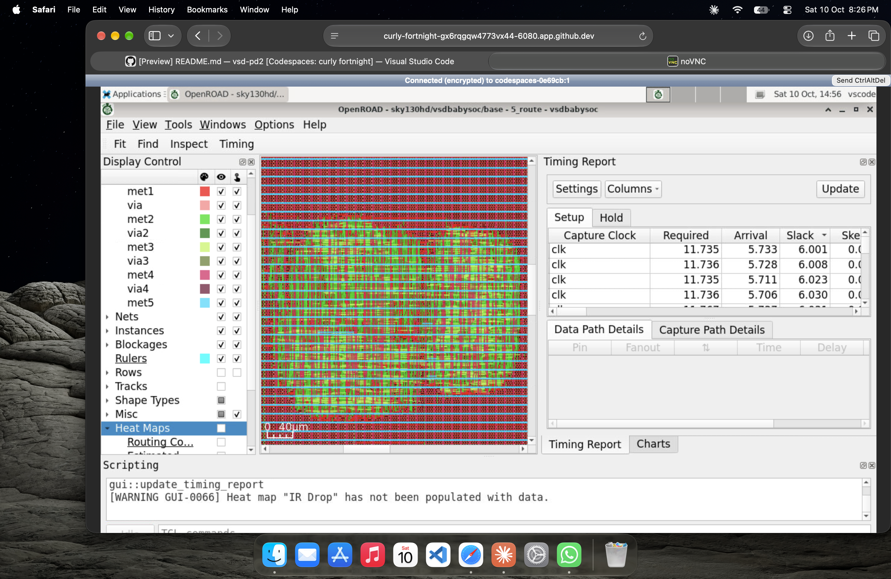
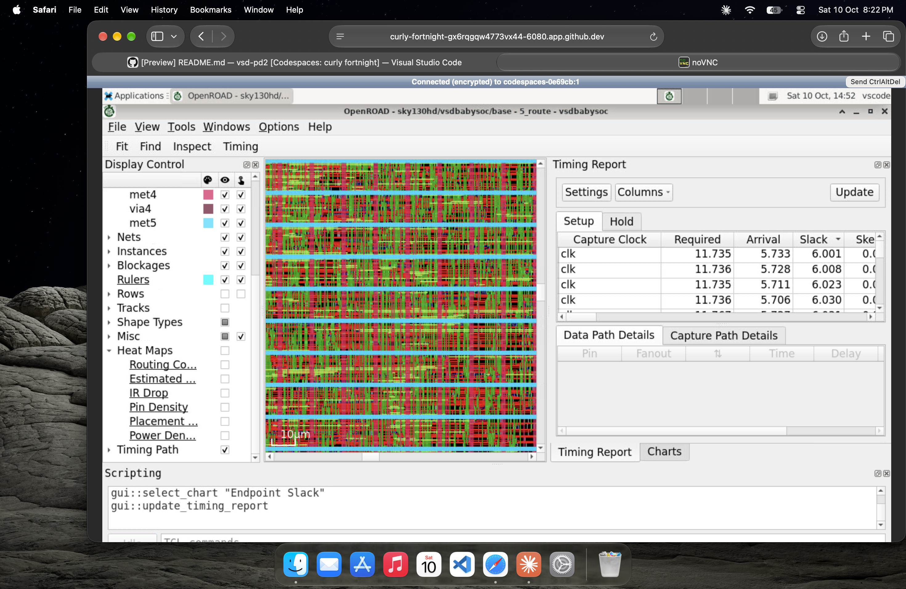
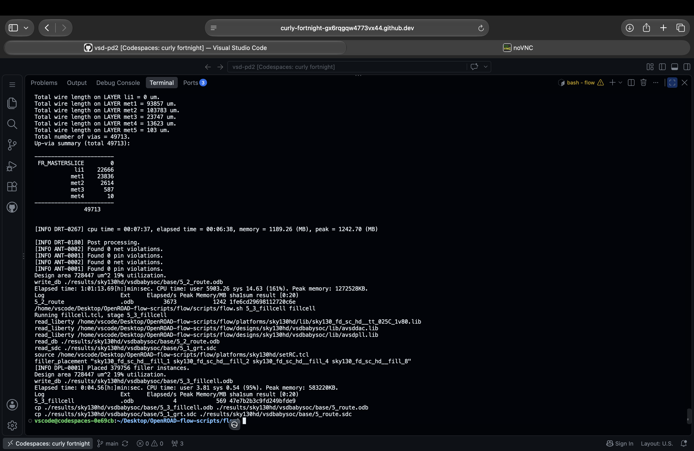

# Post-Route STA - VSDBabySoC

This folder documents the VSDBabySoC physical-design flow from floorplanning through placement, clock-tree synthesis (CTS), routing, and static timing analysis (STA). The screenshots capture intermediate tool views and run results, while the two PDF reports provide the pre-route and post-route timing results across 16 corners.

Click any screenshot to open it at full size. Click a report name to open the PDF.

## Flow Overview

`Floorplanning` -> `placement` -> `CTS` -> `global routing` -> `detailed routing` -> `post-route STA`

## Timing Reports

### `PRE_STA_16_CORNERS_REPORT.pdf` - Pre-route timing baseline

This 16-corner STA report records timing before the route stage. Use it as the baseline when comparing timing across the physical-design flow.

[Open the pre-route 16-corner STA report](PRE_STA_16_CORNERS_REPORT.pdf)

### `POST_STA_16_CORNERS_REPORT.pdf` - Post-route timing results

This 16-corner STA report records timing after routing. Compare it with the pre-route report to see how routed parasitics and the completed physical implementation affect timing across the reported corners.

[Open the post-route 16-corner STA report](POST_STA_16_CORNERS_REPORT.pdf)

## Image-by-Image Guide

### 1. Floorplanning

#### `floorplan_dac.png` - Floorplan view with endpoint-slack chart

This OpenROAD floorplan view shows the PLL macro in the layout alongside an endpoint-slack histogram for clock `clk`. It connects the macro's floorplan location with the timing-chart view available at this stage.

#### `floorplan_pll.png` - Floorplan view with selected DAC macro

This OpenROAD view shows the floorplan with the DAC macro selected in the Inspector. Use it to inspect the macro's location, orientation, and locked placement status in the design.

### 2. Placement

#### `placement1.png` - Placement timing and endpoint-slack chart

This placement-stage view shows the design layout alongside an endpoint-slack histogram for clock `clk`. The chart summarizes endpoint slack values at this implementation stage.

#### `placement2.png` - Detailed view of the placed DAC macro

This closer OpenROAD view shows the DAC macro selected in the Inspector, with its placement status, orientation, and coordinates. It provides a more detailed look at the macro placement than the full-design view.

#### `placement_heatmap.png` - Placement-stage design and timing report

This OpenROAD view shows the placed design with a setup timing report open. The report lists required time, arrival time, and slack for paths captured at this stage.

### 3. Clock-Tree Synthesis

#### `cts_heatmap.png` - CTS-stage layout view

This OpenROAD view shows the design during the CTS stage with physical layers visible. It provides a visual checkpoint of the design layout after clock-tree synthesis.

#### `cts_successful.png` - CTS run completion

The terminal output shows the CTS run completing and writing the final CTS database and timing constraints. The displayed repair summary reports that no setup or hold violations were found during the shown repair step.

### 4. Routing

#### `routing_firstrun.png` - First global-routing attempt

This terminal capture shows a global-routing run ending with congestion and overflow. Treat it as an intermediate unsuccessful attempt; it is not evidence that routing completed successfully.

#### `routing_gui1.png` - Routed layout with setup timing report

This OpenROAD view shows routed geometry alongside a setup timing report. The report table includes required time, arrival time, and slack for the displayed paths.

#### `routing_gui2.png` - Routed layout and timing-report view

This screenshot provides another routed-design view with the timing report open. Compare it with the preceding GUI view to inspect the displayed route geometry and path timing.

#### `routing_successful.png` - Routing completion and violation checks

The terminal output shows the detailed-routing run finishing and writing the routed database. The displayed post-processing checks report zero net and pin violations for this run.

## Reading the Evidence

The screenshots preserve different stages and outcomes: the first global-routing capture shows congestion, while the later detailed-routing completion capture reports zero net and pin violations. The pre-route and post-route 16-corner PDFs are the reports to consult when comparing timing before and after routing; use the detailed path and slack values in those reports rather than inferring final timing from a GUI screenshot alone.
